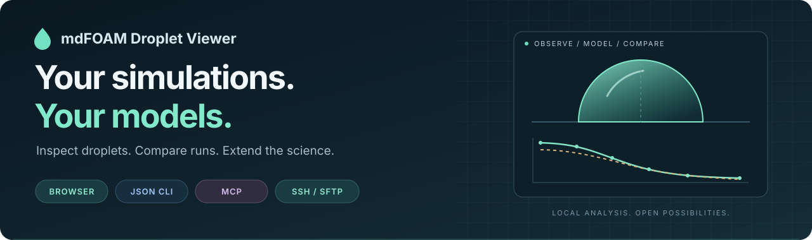
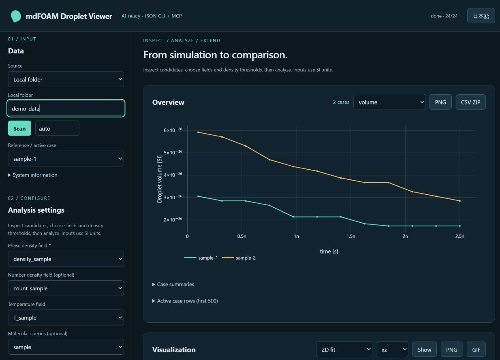

<div align="center">

<h1>mdFOAM Droplet Viewer</h1>



<br>

**An extensible workspace for mdFOAM droplet analysis.**

Connect over SSH. Explore in the browser. Automate with AI. Bring your own models.

[](https://github.com/Kaito-Rowing/mdfoam-droplet-viewer/actions/workflows/ci.yml)
[](https://github.com/Kaito-Rowing/mdfoam-droplet-viewer/releases/latest)
[](pyproject.toml)
[](docs/AI.md)
[](#from-compute-server-to-local-insight)
[](LICENSE)

[Quick start](#quick-start) · [SSH / SFTP](#from-compute-server-to-local-insight) · [AI & automation](#ai--automation) · [Custom models](#your-model-your-workflow) · [Documentation](#documentation) · [日本語](docs/README.ja.md)

</div>

---

Turn ASCII OpenFOAM outputs into droplet measurements, comparisons, and fitted models. Choose your fields, species, thresholds, and substrate orientation, then use the same analysis engine through a **browser GUI**, a **JSON CLI**, or **MCP tools**.

**Your results can stay on the compute server until you need them.** Browse cases over SSH/SFTP, retrieve the files needed for your analysis, and explore the results locally.

<p align="center">
  
  <br>
  <sub>Two synthetic runs, one local workspace. Generate the demo yourself with a single command.</sub>
</p>

## Built for the way you work

| Explore visually | Automate with AI | Extend with your science |
| :--- | :--- | :--- |
| Compare runs, inspect density slices and sphere fits, and explore 3D data. | Discover schemas, launch analysis, monitor jobs, fit models, and export figures. | Enter an expression or install a Python model with your own numerical methods. |
| **Browser GUI** | **JSON CLI + stdio MCP** | **Expressions + Python extensions** |

- **Measure droplets** — volume, equivalent radius, contact angle/radius, temperature, and ideal-gas pressure estimates.
- **Connect to your compute server** — browse remote cases over SSH/SFTP, transfer selected fields and timesteps, and reuse up-to-date local copies.
- **Bring your cases** — local reconstructed or decomposed data, arbitrary field/species/zone names, and all six axis-aligned substrate normals.
- **Keep work reproducible** — incremental analysis, named snapshots, saved model definitions and fits, and CSV / PNG / GIF export.

## Quick start

Requires **Python 3.10+**. Tested on **Windows, Linux, and macOS**.

```sh
git clone https://github.com/Kaito-Rowing/mdfoam-droplet-viewer.git
cd mdfoam-droplet-viewer
python -m venv .venv
```

<details>
<summary><strong>Activate your environment</strong></summary>

**Windows · PowerShell**

```powershell
.venv\Scripts\Activate.ps1
```

**macOS / Linux**

```sh
source .venv/bin/activate
```

</details>

```sh
python -m pip install ".[mcp]"
mdfoam-droplet-viewer
```

Open **http://127.0.0.1:8765**. On Windows, you can also double-click **`run.bat`** to set up the environment and launch the app.

### Try it before using your own data

```sh
python -m mdfoam_droplet_viewer.demo demo-data
```

1. Scan the full path to `demo-data` in the browser.
2. Paste `demo-data/settings.json` into **All settings (JSON, SI)** and click **Apply JSON**.
3. Click **Analyze**, select a case, and explore its results.

The demo is generated from fictional droplets. For your own cases, inspect the available fields and choose explicit phase thresholds and zones. An optional water preset provides an example starting point.

> **Local by default.** The browser server listens on `127.0.0.1`. Use `--port 8800` to change the port or `--no-browser` to start without opening a tab.

## From compute server to local insight

Run simulations on your compute server and use your own PC for analysis and visualization. SSH/SFTP is built into the browser workflow and available through MCP tools.

```text
Compute server ── SSH / SFTP ──→ Local analysis ──→ Comparisons, models & figures
```

1. Choose **SSH / SFTP** and connect using an SSH alias, key, or password.
2. Browse the remote case folder, inspect the available data, and choose fields and timesteps.
3. Click **Analyze** to download the required mesh, fields, and small metadata files, then process them locally.

| Remote workflow | What it gives you |
| :--- | :--- |
| **Selective transfer** | Choose a time range and stride; fetch the fields needed for the selected analysis. |
| **Incremental updates** | Rerun as the simulation writes new timesteps; up-to-date mirrored files and unchanged analysis results are reused. |
| **Existing SSH setup** | Use `~/.ssh/config` aliases and keys, with known-host verification. Passwords and passphrases are not saved in settings or snapshots. |
| **Bulk transfer** | GNU tar streaming when available, with SFTP fallback. |

Remote input uses **reconstructed data**; run `reconstructPar` on the server first if your outputs are only in `processor*/` folders. Local decomposed data is also supported. Register a new server's host key with your regular SSH client before connecting.

→ [Remote data and storage details](docs/REFERENCE.md#storage-and-exports) · [AI tools for SSH workflows](docs/AI.md#workflow)

## AI & automation

**AI access is part of the workflow.** The GUI, CLI, and MCP tools call the same versioned operations, so an assistant can move from data inspection to a fitted model and an exported figure without opening the browser.

```text
Inspect cases → Validate settings → Analyze → Fit your model → Export figures
```

### A CLI that speaks JSON

```sh
# Discover available operations, settings, quantities, and model schemas
mdfoam-droplet schema

# Analyze and save a dataset
mdfoam-droplet analyze demo-data --settings demo-data/settings.json --save demo

# Register an example expression and fit it to a case
mdfoam-droplet call register_model --input demo-data/register.json
mdfoam-droplet call fit_model --input demo-data/fit.json --saved demo
```

Standard output stays JSON; progress goes to standard error. Responses include a specification version, success status, and structured results or errors.

**Run the complete example** — generate cases, analyze, fit, and save a PNG:

```sh
python examples/ai_workflow.py workflow-output
```

### Connect an MCP client

Use the absolute executable path from your installed environment:

```json
{
  "mcpServers": {
    "mdfoam-droplet": {
      "command": "/absolute/path/to/.venv/bin/mdfoam-droplet-mcp",
      "args": ["--root", "/absolute/path/to/analysis-workspace"]
    }
  }
}
```

On Windows, use `.venv\Scripts\mdfoam-droplet-mcp.exe` and escape backslashes in JSON. Tools cover inspection, analysis, progress/cancellation, snapshots, custom models, fitting, figures, and SSH access.

→ **[Read the AI operation guide](docs/AI.md)** for schemas, job handling, units, and reproducible workflows.

## Your model, your workflow

Define the relationship you want to investigate and compare it directly with your simulation data.

| Use an expression | Install a Python extension |
| :--- | :--- |
| Enter `a * exp(-k * x)`, choose x/y quantities, and set parameter initial values and bounds. | Implement `predict(x, parameters, context)` to use your own numerical model. |
| Evaluate curves or fit a selected case over an x interval. | Register through an installed Python entry point. |
| Get fitted parameters, RMSE, R², point counts, and convergence status. | Use the same GUI, CLI, fitting, and export operations. |

Model definitions and fitted curves travel with saved snapshots. Expressions use a restricted math interpreter; Python extensions are installed explicitly. Model inputs use SI units, degree angles, or dimensionless normalized quantities, as appropriate.

→ **[Extension contract & working template](docs/EXTENSIONS.md)** · [Python model example](examples/model-plugin)

## Documentation

| Start here | Go deeper |
| :--- | :--- |
| [日本語ガイド](docs/README.ja.md) — installation and everyday use | [Data & methods](docs/REFERENCE.md) — formats, numerical assumptions, storage, and export |
| [AI operation guide](docs/AI.md) — CLI and MCP workflows | [Model extensions](docs/EXTENSIONS.md) — expressions and Python plugins |
| [Runnable automation example](examples/ai_workflow.py) | [Releases](https://github.com/Kaito-Rowing/mdfoam-droplet-viewer/releases) · [Changelog](CHANGELOG.md) |

**Current scope:** ASCII OpenFOAM fields, spherical contact-angle fits, and axis-aligned flat substrates. Pressure is an ideal-gas estimate. Phase thresholds are dataset-specific; multiple droplets are not tracked independently. See [methods and limits](docs/REFERENCE.md#input-methods-and-limits) for details.

## Contributing

New models, synthetic examples, documentation improvements, and fixes are welcome.

```sh
python -m pip install -e ".[dev]"
python -m pytest -q
python -m build
```

Keep numerical behavior in the shared computational/service layer. Add a synthetic example and a behavioral test for new capabilities. CI covers numerical checks, CLI/HTTP agreement, a real stdio MCP workflow, loopback SSH/SFTP, and wheel installation across three operating systems.

## License

[MIT](LICENSE) © 2026 Kaito-Rowing. See [third-party notices](THIRD_PARTY_NOTICES.md) for dependency licenses. OpenFOAM source and executables are not bundled.

<div align="center">
  <sub>Built to be inspected, automated, and extended.</sub>
</div>
